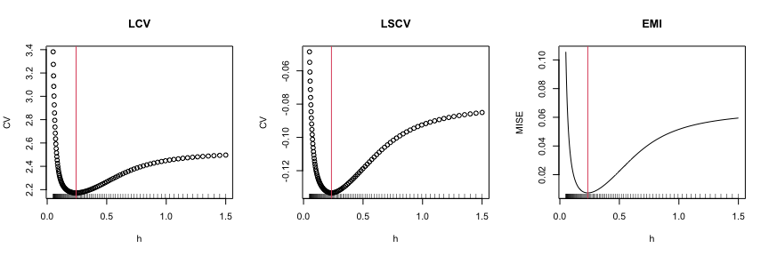
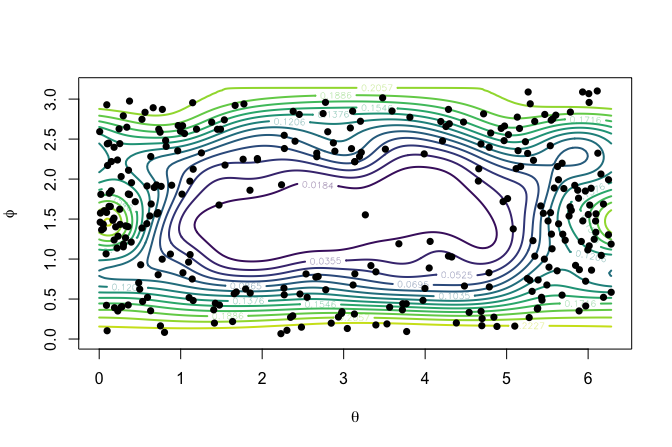
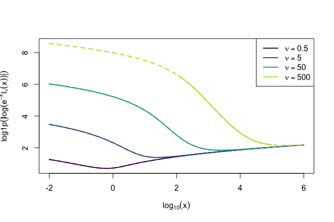

# DirStats 

[](https://www.gnu.org/licenses/gpl-3.0)
[](https://github.com/egarpor/DirStats/actions)
[](https://github.com/egarpor/DirStats/actions)
[](https://app.codecov.io/gh/egarpor/DirStats)
[](https://cran.r-project.org/package=DirStats)
[](https://cran.r-project.org/package=DirStats)
[](https://cran.r-project.org/package=DirStats)

## Overview

Implementation of nonparametric kernel density estimation, bandwidth
selection, and other utilities for analyzing directional data, such as
stable and fast evaluation of Bessel functions appearing in the von
Mises–Fisher distribution.

## Installation

``` r
# Install it from CRAN
install.packages("DirStats")
library(DirStats)
```

``` r
# Alternatively, from GitHub
library(pak)
pak("egarpor/DirStats")
library(DirStats)
```

## Usage

The following are examples of the usage of the Bai et al. (1988)’s
kernel density estimator, the cross-validatory bandwidth selectors in
Hall et al. (1987), and the plug-in bandwidth selectors in
García-Portugués (2013).

### Bandwidth selection

The bandwidth $`h`$ governs the smoothness of the estimator and is the
main practical choice to be made. Two families of selectors are
available: the cross-validatory ones, `bw_dir_lcv` (likelihood) and
`bw_dir_lscv` (least squares); and the plug-in ones, `bw_dir_rot` (rule
of thumb), `bw_dir_ami` (asymptotic mixtures), and `bw_dir_emi` (exact
mixtures). The last two build on a mixture of von Mises–Fisher
distributions fitted with `bic_vmf_mix`.

``` r
# Sample from a mixture of three von Mises--Fisher distributions on S^2
q <- 2
n <- 300
set.seed(42)
samp <- rbind(rotasym::r_vMF(n = n / 3, mu = c(rep(0, q), 1), kappa = 5),
              rotasym::r_vMF(n = n / 3, mu = c(rep(0, q), -1), kappa = 5),
              rotasym::r_vMF(n = n / 3, mu = c(1, rep(0, q)), kappa = 5))

# Mixture fit required by the AMI and EMI plug-in selectors
set.seed(42)
fit_mix <- bic_vmf_mix(data = samp)
length(fit_mix$best_fit$p_hat) # Number of fitted components
#> [1] 3

# The five bandwidth selectors
bws <- c("ROT" = bw_dir_rot(data = samp),
         "AMI" = bw_dir_ami(data = samp, fit_mix = fit_mix),
         "EMI" = bw_dir_emi(data = samp, fit_mix = fit_mix)$h_opt,
         "LCV" = bw_dir_lcv(data = samp)$h_opt,
         "LSCV" = bw_dir_lscv(data = samp)$h_opt)
round(bws, 4)
#>    ROT    AMI    EMI    LCV   LSCV 
#> 0.4144 0.2127 0.2353 0.2426 0.2345
```

The cross-validatory and the EMI selectors optimize their loss
numerically by default (`optim = TRUE`). Setting `optim = FALSE`
performs instead a grid search on `h_grid`, which can be inspected with
`plot_it = TRUE`.

``` r
# Grid search on a grid bounded away from zero
h_grid <- exp(seq(log(0.05), log(1.5), l = 100))
par(mfrow = c(1, 3))
invisible(bw_dir_lcv(data = samp, h_grid = h_grid, optim = FALSE,
                     plot_it = TRUE)); title("LCV")
invisible(bw_dir_lscv(data = samp, h_grid = h_grid, optim = FALSE,
                      plot_it = TRUE)); title("LSCV")
invisible(bw_dir_emi(data = samp, fit_mix = fit_mix, h_grid = h_grid,
                     optim = FALSE, plot_it = TRUE)); title("EMI")
```



Since the sampling density is known in this example, the selectors can
be compared through the integrated squared error of the estimators they
yield.

``` r
# True density
mu <- rbind(c(rep(0, q), 1), c(rep(0, q), -1), c(1, rep(0, q)))
f <- function(x) d_mixvmf(x = x, mu = mu, kappa = rep(5, 3), p = rep(1 / 3, 3))

# ISE of the kde for each selected bandwidth
ise <- sapply(bws, function(h) {
  int_sph(f = function(x) (kde_dir(x = x, data = samp, h = h) - f(x))^2)
})
signif(ise, 3)
#>     ROT     AMI     EMI     LCV    LSCV 
#> 0.01670 0.00604 0.00609 0.00621 0.00608
```

The rule of thumb assumes a single von Mises–Fisher density and hence
oversmooths this trimodal sample, whereas the four data-driven selectors
perform similarly.

The selectors also accept a custom kernel `L`, the von Mises–Fisher
kernel $`L(x) = e^{-x}`$ being used when `L = NULL`.

``` r
# Epanechnikov-type kernel
L <- function(x) (1 - x) * (x < 1)
bw_dir_lcv(data = samp, L = L)$h_opt
#> [1] 0.4207614
bw_dir_ami(data = samp, fit_mix = fit_mix, L = L)
#> [1] 0.3612254
```

### Compute kernel density estimator

``` r
# Compute kde
l <- 200
th <- seq(0, 2 * pi, l = l)
phi <- seq(0, pi, l = l / 2)
ang <- expand.grid(th = th, phi = phi)
x <- to_sph(th = ang$th, ph = ang$phi)
kde <- kde_dir(x = x, data = samp, h = bws["EMI"])

# Visualization
contour(x = th, y = phi, z = matrix(kde, nrow = l, ncol = l / 2),
        col = viridisLite::viridis(15),
        levels = round(seq(min(kde), max(kde), length.out = 15), 4),
        lwd = 2, xlab = expression(theta), ylab = expression(phi))
points(to_rad(samp), pch = 16)
```



### Bessel functions

`log_besselI_scaled()` evaluates $`\log(e^{-x}\mathcal{I}_\nu(x))`$ in a
stable way for either large orders $`\nu`$ or large arguments $`x`$.

``` r
# Evaluation across several orders and a wide range of arguments
x <- 10^seq(-2, 6, l = 200)
nu <- c(0.5, 5, 50, 500)
log_bessel_direct <- sapply(nu, function(n)
  log(besselI(x = x, nu = n, expon.scaled = TRUE)))
log_bessel <- sapply(nu, function(n) log_besselI_scaled(nu = n, x = x))

# The solid curves are the direct evaluations, which break down for
# large nu and small x, and for large x
col <- viridisLite::viridis(length(nu), end = 0.9)
matplot(log10(x), log1p(abs(log_bessel)), type = "l", lty = 2, lwd = 2,
        col = col, xlab = expression(log[10](x)),
        ylab = expression(log1p(abs(log(e^-x * I[nu](x))))))
matlines(log10(x), log1p(abs(log_bessel_direct)), lty = 1, lwd = 2, col = col)
legend("topright", legend = sapply(nu, function(n) bquote(nu == .(n))),
       lwd = 2, col = col)
```



## References

Bai, Z. D., Rao, C. R., and Zhao, L. C. (1988). Kernel estimators of
density function of directional data. *Journal of Multivariate
Analysis*, 27(1):24–39.
[doi:10.1016/0047-259X(88)90113-3](https://doi.org/10.1016/0047-259X(88)90113-3).

García-Portugués, E. (2013). Exact risk improvement of bandwidth
selectors for kernel density estimation with directional data.
*Electronic Journal of Statistics*, 7:1655–1685.
[doi:10.1214/13-EJS821](https://doi.org/10.1214/13-EJS821).

Hall, P., Watson, G. S., and Cabrera, J. (1987). Kernel density
estimation with spherical data. *Biometrika*, 74(4):751–762.
[doi:10.1093/biomet/74.4.751](https://doi.org/10.1093/biomet/74.4.751).
